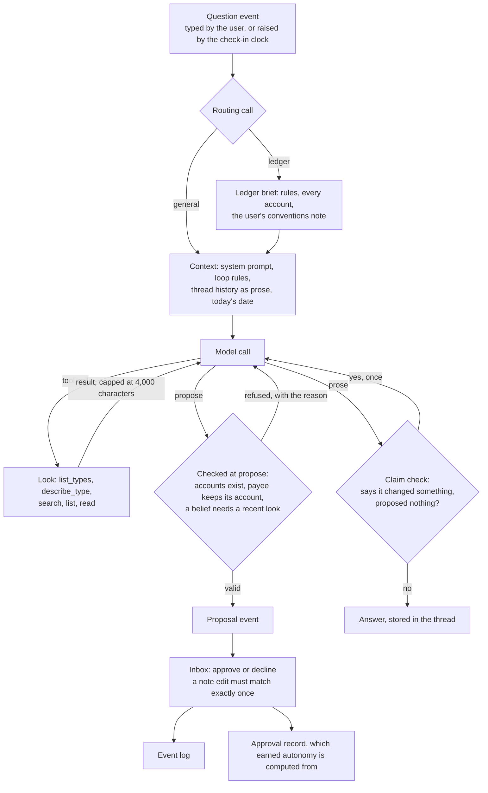

# How the agents are composed

omni-me runs thirteen jobs on its own, and only one of them is an agent. This page describes
all of them in the vocabulary used for agentic systems such as Claude Code or Codex: the loop,
tools, context, sub-agents, memory and verification. Each section gives the general idea, how
omni-me does it, and where it falls short. What the assistant is *allowed* to do is a separate
contract, in [The assistant](assistant.md); this page is about how it is built.

## Agent, workflow, or plain code

The distinction that matters most is who chooses the next step.

- **An agent** is a model in a loop that decides its own next step: it calls a tool, reads the
  result, and decides again until it answers.
- **A workflow** fixes the steps in code and asks a model to fill in one of them: here is an
  email, return this JSON.
- **Plain code** may call a model as a function (an embedder turning text into a vector), but no
  model generates anything or chooses anything.

Workflows are cheaper, predictable and testable. An agent earns its cost only where the steps
cannot be known in advance. Sorted that way, omni-me's jobs are:

| Shape | Device | Server | Agent host |
|---|---|---|---|
| Agent | | | answering a question; the daily check-in |
| Workflow | | mail import (C0 triage, then C1 extraction); old-mail backfill (one screening call); document enrichment (C2 reader, or C3 transcriber for scans); note structuring (D) | |
| Plain code | recurring detection; journal auto-close; retention candidates | bank import | chat tidying; search-index refresh |
| Inline | duplicate and reconciliation flags, computed on import or on read | | |

The daily check-in is not a job of its own shape. On the hour it writes a question event with
the saved check-in prompt, exactly as if the user had typed it (`agent/src/responder.rs`), and
the same agent answers it. What starts a job and what shape the job has are independent, which
is why a trigger has to be described separately from everything else about a job.

The consequence for the rest of the page: the agent vocabulary fits one job well, and the other
twelve are a job-scheduling problem rather than an agent problem.

## The agent, end to end

## The loop

A model on its own takes text in and gives text out. A harness around it sends the whole
conversation, runs any tool call in the reply, appends the result, and sends again; a reply with
no tool call is the answer. Two consequences shape everything below. The model remembers nothing
between calls, so every turn re-sends everything gathered so far. And stopping is the model's
choice unless the harness imposes one.

omni-me imposes one, because there is no "I'm done" verb and a model can search until it runs
out of turns: on the prototype that happened in 11 of 24 episodes. The loop in
`core/src/assistant/session.rs` has a budget of 15 turns (a config setting), plus 4 that only
`propose` may spend, so research that ran long can still end in the change asked for. On the
last turn the lookups are withdrawn and the model is told to answer from what it has.

## Tools

A tool is a name, a description and an argument schema, and the description is all the model
ever sees of it. Tool design therefore moves quality more than most changes to the model.

There are two ways to build a set. One tool per action grows with the app and hands the model a
long menu. A few generic verbs over a world that describes itself is how Claude Code works: a
handful of tools over a filesystem, where listing a directory shows what exists. omni-me takes
the second approach with six verbs (`core/src/assistant/verbs.rs`), and the record-type catalogue
in place of a filesystem:

| Verb | Claude Code's nearest equivalent | Job |
|---|---|---|
| `list_types` | listing a directory | what kinds of records exist |
| `describe_type` | reading a file's documentation | fields, filters and which changes are allowed |
| `search` | grep | find by meaning or wording |
| `list` | listing with filters | "what X do I have", anything scoped by date |
| `read` | reading a file | one record in full |
| `propose` | editing, but gated | ask for a change |

A new record type becomes usable with no tool change. The cost is the mirror image: an action
whose type is not in the catalogue cannot be found at all, and nothing warns.

The place omni-me deliberately departs from Claude Code is the gate. Claude Code has a catch-all
shell tool and asks before running it, which works because a person is watching. omni-me's agent
mostly runs while nobody is, so `propose` never executes anything: it files a proposal that can
wait in the inbox for days, and the loop finishes meanwhile. The proposal is also described in
the domain's terms ("record this charge under this account") rather than as a mechanism, which
is what lets a person judge it at a glance and what lets autonomy be granted per action. A
catch-all could only ever be granted all or nothing.

## Context

The context is everything in one request, and it is paid for on every turn. Past a point more of
it makes the model worse, not better, so the design question is what to load up front (always
seen, always paid for) and what to leave for the model to fetch (cheap, but only if it knows to
look, and each look costs a turn).

One request is assembled in this order:

1. The system prompt and the loop rules, fixed.
2. A routing call decides between `general` and `ledger` (`core/src/assistant/specialist.rs`).
   A ledger request gets the ledger rules, the full list of accounts and the user's conventions
   note. A general one gets nothing extra.
3. Today's date, last. Providers cache an unchanged prefix, so the part that changes every
   minute goes after the part that rarely does.
4. The thread's earlier questions and answers, as prose. Tool calls and results from earlier
   answers are not carried.
5. This run's tool calls and results.

The routing call costs an extra model call per question, and a separate call rather than a
`load_brief` tool the agent could choose for itself is a deliberate trade. A model left to
decide may skip the brief when it is needed or load it repeatedly. The account list in the
brief is also what a proposed transaction is checked against, so skipping it would cost turns
spent correcting guesses. A failed or unclear routing call falls back to `general`, which is
safe because the protection lives in the gate, not the brief.

## Sub-agents

A sub-agent is a tool whose implementation is another agent loop, with its own fresh context,
that returns only its final report. It buys isolation (thirty files read by the child never
reach the parent), parallelism and specialisation. It costs a cold start, a handoff where the
parent sees conclusions but not evidence, and multiplied tokens. It pays off when the subtasks
are independent and the result compresses well, and it fails on tightly coupled work, where
agents running in parallel make decisions they cannot see each other make.

omni-me has none, and three things only look like them: the ledger specialist is the same agent
with a different brief, mail import's two steps are a pipeline with code passing one call's
output to the next, and the check-in is the agent itself on a timer.

## Memory

Agent memory is usefully divided by what it holds: the current task (the context), what happened
(episodic), facts and rules (semantic), and how to do things (procedural). For any of them, four
questions matter: who writes it, when it is read, how it is kept true, and what bounds it.

| Kind | omni-me | Written by | Kept true by |
|---|---|---|---|
| What happened | the event log, and the chat threads | the system, signed | events are append-only |
| Facts | beliefs, a catalogued record type read on demand | the agent proposes, the user approves | retired beliefs stay readable, so the set is audited rather than trusted (`core/src/assistant/memory.rs`) |
| How to do things | none in the agent | | |

The empty row is deliberate for a system that writes to someone's ledger, but it says where
learning actually happens. Every improvement so far came from the same loop: a failure found in
use, a development session changing the code or a prompt, and a bench (`agent/src/*_bench.rs`)
measuring the change. The agent's procedural memory is the code.

## Verification

The model's reply is a claim and its tool calls are the evidence. Checks come in three
strengths. Deterministic checks in the harness cannot be argued with. Checks against the world
(running the code, or a person approving a proposal) rest on a ground truth outside the model. A
model checking a model is the weakest, because the checker shares the blind spots of what it
checks.

omni-me's agent has all three:

- **Deterministic:** an account must already exist and a known payee keeps its account
  (`ledger_grounding.rs`); a mid-note edit must match its anchor exactly once or the approval is
  refused (`revise.rs`); a belief cannot be recorded without a recent look at the evidence;
  irreversible actions can never be granted autonomy.
- **Against the world:** the user, at approval.
- **A heuristic over the reply:** `claims.rs` notices a reply that says something changed when
  nothing was proposed, and asks once more. It runs only when nothing was proposed, so a false
  alarm costs one model call and never a wrong write. How accurate a check must be follows from
  what its errors cost.

## Gaps

In order of how much they matter now:

1. **No job leaves a record that trust can be built from.** The agent has one: every proposal
   records what was decided, and earned autonomy is a query over it. The other jobs do not, and
   for high-volume output like document enrichment, trust cannot come from reviewing everything.
   A per-job record of runs and outcomes, plus checking a random sample, is the shape of a fix.
   The [job contract](#the-job-contract) below starts it; jobs gain a record as they migrate.
2. **Jobs run on three hosts with three schedulers** and no rule for which goes where. The
   contract's placement rule is the answer, applied one job at a time.
3. **Factual claims are unchecked.** The claim check covers changes, not statements about
   records. Citations (every factual sentence points at a record the run retrieved, and code
   verifies the pointer) are the published fix.
4. **Context has no compaction**, so a long thread grows without bound, and earlier findings are
   dropped between questions, which is a trade of turns for cost and privacy rather than a bug.

## The job contract

Every job that runs on its own declares the same record (`core/src/jobs/mod.rs`): its name and
shape, what triggers it, which host it runs on, its off switch, its failure policy, where its
output lands and at which notification tier, and, for a job that calls a model, its seats with
their effort, its per-run budget and its permission (read, propose or autonomous). The point is
less any one field than that every job answers the same questions, so a gap shows as a blank
rather than as nothing at all. Mail import declares "no cap per run", for instance: the budget
is unbounded today, and the declaration makes that visible instead of implicit.

**A registry lists every job.** Jobs on the contract carry the full record; the rest are listed
by name, shape and host until they migrate, so the list is complete from the first day. Jobs
move one at a time, mail import first, and never in a mass move.

**Each run leaves a record**: start, end, outcome, counts and spend. Trust is built from that
record rather than from checking every output. The records sit in a table on the host that ran
the job, not in the event log: a poll every half hour per account would put thousands of rows a
month into a log that is permanent and copied to every device. They are kept for 90 days, long
enough to measure the critical-alert budget over weeks. Spend comes from the provider's own
per-call cost figure, metered around the run, so a job needs no plumbing of its own to report
it; a call that reports no cost is counted as unpriced, never as free. A correction record
(what the user changed in a job's output) is the next field, and waits for enrichment to migrate.

**Placement.** A job runs on a device only if it must work offline or is computed when a screen
opens. Otherwise it runs on the server, and intake always does. The agent host takes only the
agent loop and what serves it. One rule is enforced by a test: a job may only sit on a host that
folds every table it reads, because a table a host does not fold reads back empty and nothing
says so. The test can check only what a job declares it reads, so the declaration is the part to
review when a job changes.

**The status view** is Settings → Jobs: one line per job with its health and last run, the last
20 runs when expanded, and the jobs not yet on the contract listed beneath.

## Scaling the codebase without per-area agents

One idea for managing a growing codebase is an agent per area of the app, mirroring how separate
teams own separate parts of a product. It was weighed against a general development session and
rejected. An area agent beats a general session only if it carries something forward, and what
it would carry is the area's traps, rulings and past failures. A file holding those can be loaded
by a general session just as well, and the tests measure both equally. The separate agent then
adds only a cold start and a lossy handoff on every task.

So area knowledge goes into path-scoped instruction files, which the development tool loads
automatically when matching files are touched. Procedures go into skills that are invoked on
purpose, and the existing tests stay the feedback loop: module tests for the code, benches for
the runtime agent. A summary of the code is the one thing such a file should never hold,
because it goes stale while the code it describes keeps moving.
